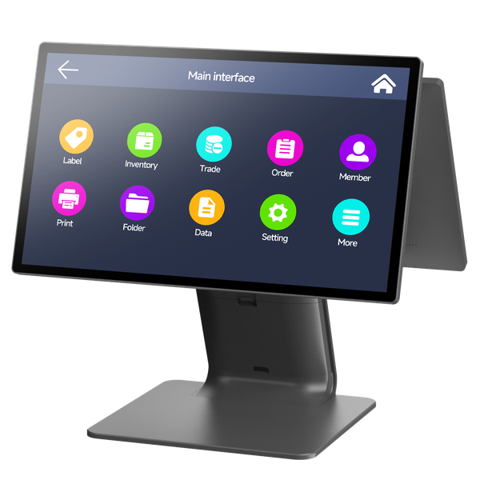
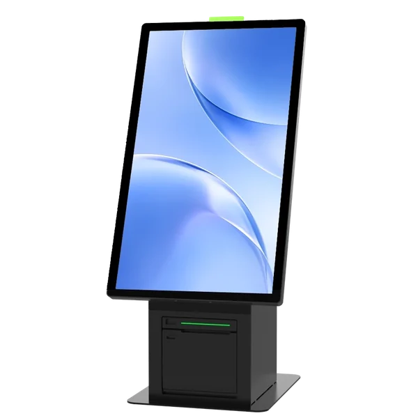
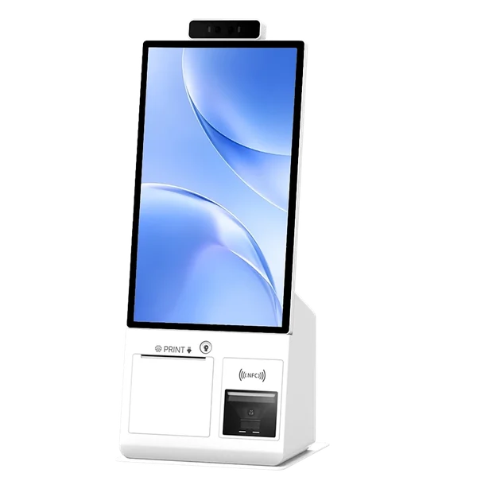
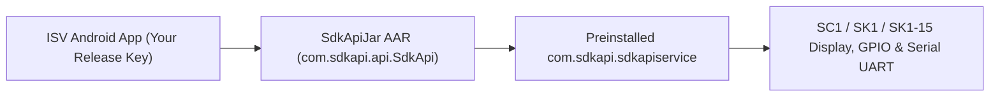

<div align="center">
  <a href="https://www.suntekai.com">
    <picture>
      <source media="(prefers-color-scheme: dark)" srcset="./assets/logo-dark.png">
      <source media="(prefers-color-scheme: light)" srcset="./assets/logo-light.png">
      
    </picture>
  </a>

  <h1>SUNTEK SC1 / SK1 / SK1-15 Android System SDK</h1>

  <p>
    <strong>Official Hardware SDK &amp; Developer Kit</strong> &middot; <em>Enjoy Smarter Service</em><br>
    Unified Android hardware and system control SDK shared across <strong>SC1</strong> (Desktop POS), <strong>SK1</strong> (Self-Service Kiosk), and <strong>SK1-15</strong> (15.6-inch Kiosk) terminals by <strong>SUNTEK Technology Co., Ltd.</strong> Supports both <strong>GMS</strong> and <strong>Non-GMS</strong> firmware.
  </p>

  <p>
    <a href="./LICENSE"></a>
    <a href="https://github.com/SUNTEK-Official/suntek-sdk-sc1-sk1/releases"></a>
    
    <a href="https://www.suntekai.com/products/suntek-desktop-pos-terminal-sc1/"></a>
    <a href="mailto:support@suntekai.com"></a>
  </p>

  <p>
    <a href="#hardware-showcase--compatibility">Hardware</a> &nbsp;&bull;&nbsp;
    <a href="#architecture--key-capabilities">Architecture</a> &nbsp;&bull;&nbsp;
    <a href="#supported-interfaces--physical-connections">Interfaces</a> &nbsp;&bull;&nbsp;
    <a href="#5-minute-quick-start">Quick Start</a> &nbsp;&bull;&nbsp;
    <a href="#sample-apps--prebuilt-downloads">Downloads</a> &nbsp;&bull;&nbsp;
    <a href="#troubleshooting--faq">FAQ</a> &nbsp;&bull;&nbsp;
    <a href="#documentation-changelog--support">Support</a>
  </p>
  
</div>

---

## Hardware Showcase & Compatibility

<table>
  <tr>
    <td align="center" width="33%">
      <a href="https://www.suntekai.com/products/suntek-desktop-pos-terminal-sc1/">
        
      </a>
      <br>
      <strong>SC1</strong><br>
      <sub>Desktop POS Terminal</sub><br>
      <a href="https://www.suntekai.com/products/suntek-desktop-pos-terminal-sc1/">Official Product Page</a>
    </td>
    <td align="center" width="33%">
      <a href="https://www.suntekai.com/products/suntek-self-service-kiosk-sk1/">
        
      </a>
      <br>
      <strong>SK1</strong><br>
      <sub>Self-Service Kiosk</sub><br>
      <a href="https://www.suntekai.com/products/suntek-self-service-kiosk-sk1/">Official Product Page</a>
    </td>
    <td align="center" width="33%">
      <a href="https://www.suntekai.com/products/suntek-self-service-kiosk-sk1-15/">
        
      </a>
      <br>
      <strong>SK1-15</strong><br>
      <sub>15.6-inch Mini Kiosk</sub><br>
      <a href="https://www.suntekai.com/products/suntek-self-service-kiosk-sk1-15/">Official Product Page</a>
    </td>
  </tr>
</table>

| Product Model | Chipset / Board | OS Versions | Build Identifier | Status |
| :--- | :--- | :--- | :--- | :---: |
| **SC1** | Rockchip Platform | Android 10 - 14 (GMS & Non-GMS) | `SC1*` / `GMS` / `NoGMS` | Supported |
| **SK1** | Rockchip Platform | Android 10 - 14 (GMS & Non-GMS) | `SK1*` | Supported |
| **SK1-15** | Rockchip Platform | Android 10 - 14 (GMS & Non-GMS) | `SK1-15*` | Supported |

> [!IMPORTANT]
> Verify your device **Model** and **Build Number** under Android **Settings -> About device** before integration. Customer applications use your own Google Play or enterprise release certificate.

---

## Architecture & Key Capabilities

- **Unified Multi-Model Compatibility**: One shared `SdkApiJar` AAR API supports `SC1`, `SK1`, and `SK1-15` terminals identically.
- **GMS & Non-GMS Builds Included**: Separate `sdk-gms/` (`V1.260410.0350`) and `sdk-non-gms/` (`V1.250915.0914`) distributions.
- **Full Terminal Hardware Control**: Device identity (`SN` / `Firmware`), navigation/status bar lockdown, UART `/dev/ttyS0..4`, GPIO, and RTC power scheduling.



---

## Supported Interfaces & Physical Connections

| Hardware Feature | Interface Type | Device Path / Service Target | Notes |
| :--- | :--- | :--- | :--- |
| **Preinstalled System IPC** | Binder Service (`com.sdkapi`) | `com.sdkapi.sdkapiservice` | Auto-bound by SDK on factory ROM |
| **Display & Navigation** | SdkApi Display Module | `DisplayManager / Screen Rotation` | Hide nav/status bar, secondary screen |
| **GPIO & Serial UART** | SdkApi Hardware I/O | `/dev/ttyS0 .. /dev/ttyS4` | RS232/RS485/TTL port power & I/O |
| **Watchdog & Power** | SdkApi System Ctrl | `Scheduled Power On/Off / Reboot` | Kiosk unattended reliability |

---

## Repository Directory Layout

```text
suntek-sdk-sc1-sk1/
├── assets/                 # Official SUNTEK logos, hero banners & SC1/SK1/SK1-15 photos
├── sdk-gms/
│   ├── SdkApiJar_V1.260410.0350.aar
│   └── gms-api-reference.md
├── sdk-non-gms/
│   ├── SdkApiJar_V1.250915.0914.aar
│   └── SdkApi-Guidance-EN.pdf
├── sample-android/         # Ready-to-build Android Studio sample (com.suntek.sample.sc1sk1)
├── README.md
├── LICENSE
├── THIRD_PARTY_NOTICES.md
└── CHANGELOG.md
```

> All installers (`.exe`), compiled sample APKs (`.apk`), and large binary packages (> 5 MB) are hosted on [**GitHub Releases**](https://github.com/SUNTEK-Official/suntek-sdk-sc1-sk1/releases) with `SHA256SUMS.txt`.

---

## Prerequisites & Permissions

- **Platform Target**: `minSdk 24` / `targetSdk 35`
- **App Signing Requirement**: Sign your business app with your **own Google Play or enterprise release key** (IPC via `com.sdkapi.sdkapiservice`). No platform signing key is required. For privileged system operations on managed fleets, install companion `SuntekBridgeService.apk` from GitHub Releases or contact `support@suntekai.com`.
- **Required Permissions / Capabilities**: `INTERNET`, `RECEIVE_BOOT_COMPLETED`, and `<queries><package android:name="com.sdkapi.sdkapiservice" /></queries>` (bundled in AAR manifest).

---

## 5-Minute Quick Start

### Step 1: Add Matching AAR Dependency

```gradle
// Copy sdk-gms/SdkApiJar_V1.260410.0350.aar or sdk-non-gms/SdkApiJar_V1.250915.0914.aar into app/libs/
dependencies {
    implementation files('libs/SdkApiJar_V1.260410.0350.aar')
}
```

### Step 2: Initialize SDK & Query Hardware State

```java
import com.sdkapi.api.SdkApi;

public void initTerminalHardware(Context context) {
    SdkApi.newInstance(context.getApplicationContext());
    if (SdkApi.getInstance() != null && SdkApi.getInstance().getServiceConnectionStatus()) {
        String sn = SdkApi.getInstance().DeviceInfo().getSerialNumber();
        String fw = SdkApi.getInstance().DeviceInfo().getFirmwareVersion();
        SdkApi.getInstance().SystemCtrl().setNavigationBar(false);
    }
}
```

### Build & Run Sample Project

```bash
cd sample-android && ./gradlew assembleDebug
```

---

## Sample Apps & Prebuilt Downloads

Verified prebuilt APKs, offline SDK bundles, and checksum manifests are published on [**GitHub Releases**](https://github.com/SUNTEK-Official/suntek-sdk-sc1-sk1/releases). Verify downloaded archives before production deployment:

```bash
shasum -a 256 -c SHA256SUMS.txt
```

---

## Troubleshooting & FAQ

<details>
<summary><b>How do I choose between `sdk-gms/` and `sdk-non-gms/`?</b></summary>
<p>Check whether Google Play Services is installed under Settings -> Apps. Use `sdk-gms/` for GMS builds and `sdk-non-gms/` for AOSP/Non-GMS firmware.</p>
</details>

<details>
<summary><b>Which certificate should I use to sign my Android APK?</b></summary>
<p>Sign with your own Google Play or enterprise release certificate. `com.sdkapi.sdkapiservice` is preinstalled on SC1/SK1/SK1-15 firmware.</p>
</details>

<details>
<summary><b>Which models share `suntek-sdk-sc1-sk1`?</b></summary>
<p>SC1 (Desktop POS), SK1 (Self-Service Kiosk), and SK1-15 (15.6-inch Self-Service Kiosk) share identical board interfaces and AAR binaries.</p>
</details>

---

## Documentation, Changelog & Support

- **Changelog**: [CHANGELOG.md](./CHANGELOG.md)
- **Developer Documentation Portal**: [suntek-docs](https://github.com/SUNTEK-Official/suntek-docs)
- **Technical Support**: [support@suntekai.com](mailto:support@suntekai.com)
- **Bug Reports**: [Open an Issue](https://github.com/SUNTEK-Official/.github/issues/new/choose)
- **Security Disclosures**: See [SECURITY.md](https://github.com/SUNTEK-Official/.github/blob/main/SECURITY.md) or email [support@suntekai.com](mailto:support@suntekai.com)

---

<div align="center">
  
  <br><br>
  <strong>SUNTEK Technology Co., Ltd.</strong> &mdash; <em>Smart Commercial Terminal Hardware Manufacturer Since 2010</em><br>
  <sub>80+ Export Countries &middot; 5,000,000+ Terminals Shipped &middot; 500+ ODM Projects &middot; ISO 9001 / ISO 14001 / ISO 27001 / CE / RoHS</sub><br>
  <sub><a href="https://www.suntekai.com">www.suntekai.com</a> &middot; Copyright &copy; 2026 SUNTEK Technology Co., Ltd. All rights reserved.</sub>
</div>
